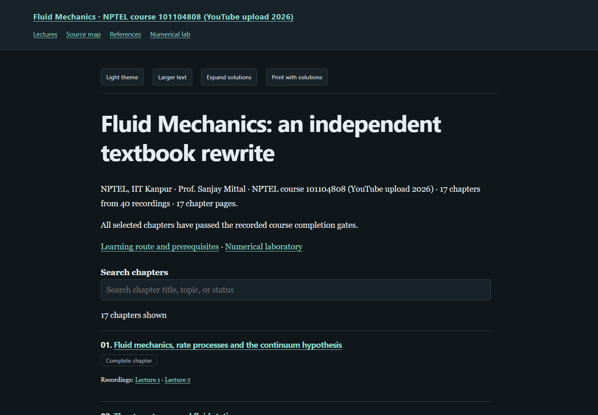

# Fluid Mechanics — a textbook rewrite

**[Read the live textbook](https://az9713.github.io/nptel-fluid-mechanics-kanpur-notes/)**

[](https://az9713.github.io/nptel-fluid-mechanics-kanpur-notes/)

This project is an independent rewrite and expansion of the course materials
for Prof. Sanjay Mittal's NPTEL IIT Kanpur
[Fluid Mechanics](https://nptel.ac.in/courses/101104808).
The **[YouTube playlist](https://www.youtube.com/playlist?list=PLFW6lRTa1g81Aty79boPFJpzOpGd6Nlh2)
serves as the spine**: it sets the topic sequence and provides timestamped
anchors for the exposition.

Around that spine, the project develops original explanations, definitions,
derivations, diagrams, runnable Python examples, and fully worked problems.
Inspected primary research extends and checks the lecture material. Source
maps distinguish lecture content, research evidence, and original teaching
constructions; empirical observations and synthetic examples carry separate
labels.

All **33 numbered lectures** are covered in **17 chronological topic chapters**,
with **102 worked chapter problems** and **two numerical-lab studies**.
Seven lectures are split into two parts, giving **40 recordings**, each assigned
once in the chapter source records. Publisher-provided caption pairs are retained
outside this repository. The source videos were intentionally deleted; retained
captions and selected frames support the recorded editorial evidence. Current
full-media verification or new playback is not claimed.

The reader includes searchable chapter navigation, local MathJax, light/dark
themes, adjustable text size, expandable solutions, printing with solutions,
and a numerical laboratory with downloadable Python code. Rendering assets are
bundled, so a downloaded copy also works offline.

Explore the [source map](https://az9713.github.io/nptel-fluid-mechanics-kanpur-notes/source-map.html),
[primary references](https://az9713.github.io/nptel-fluid-mechanics-kanpur-notes/references.html),
and [numerical lab](https://az9713.github.io/nptel-fluid-mechanics-kanpur-notes/numerical-lab.html).
The preview above opens the live GitHub Pages edition, served from `index.html`.

## Run locally

Open `index.html` after downloading the repository. To rebuild and check it:

```sh
python tools/build_book.py
python tools/validate_books.py --browser
python numerical_lab.py
python tools/audit_numerical_lab.py
python tools/check_chapter_code.py
```

The rebuild, downloadable numerical laboratory, and numerical audit use Python's
standard library. Browser checks require Python Playwright and an installed
supported browser. Some chapter listings require NumPy; their imports are
shown with the examples.

## Evidence and scope

Independent chapter review accepted all 17 chapters. Independent supporting-material
review accepted the learning route and numerical laboratory with zero blocking
findings. All 17 Python listings passed actual isolated execution and matched
their displayed output. The laboratory checks prescribed-field finite-volume
continuity and exact laminar-pipe quadrature and wall-force closure, including
refinement and deliberate sign-error probes. These are constructed-model
implementation checks, not real-flow validation.

Offline desktop/mobile reader checks passed. The assembled-book acceptance and
metadata audits passed with 14 nonblocking warnings for additional revision fields;
this does not assert a new independent whole-book mathematical review.
An isolated, source-free Git export rebuilt all 22 HTML files byte-for-byte and
passed all executable checks and 43 offline page-and-viewport checks. Live
publication checks passed for served-file integrity, desktop/mobile reader
controls, and the GitHub-rendered preview linking to the live book.

The [workflow](WORKFLOW.md), [source record](source-validation-summary.json),
[editorial record](editorial-review-summary.json), [course review](course-review.json),
[code checks](chapter-code-validation.json), [reader checks](reader-validation.json),
[clean-export checks](source-free-validation.json), and
[package checks](package-validation.json) retain the evidence and its limits.
Full audiovisual review and human accessibility certification are not claimed.
The [publication check](publication-validation.json) records the scope and outcome
of served-file, live reader, and README-preview checks.

Public files contain the rewritten textbook, supporting code, source citations,
and curated verification records. Raw recordings, transcripts, downloaded
papers, acquisition logs, and private editorial records remain outside this
repository. Published instructor and research-author names are retained for
source attribution.
